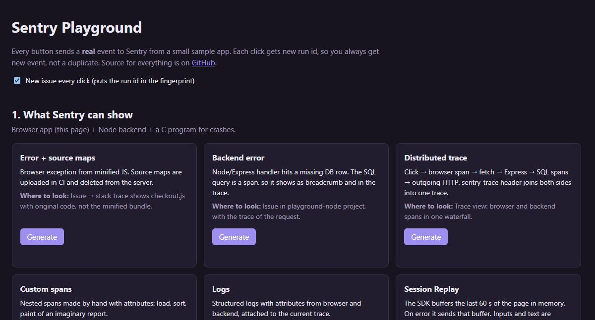
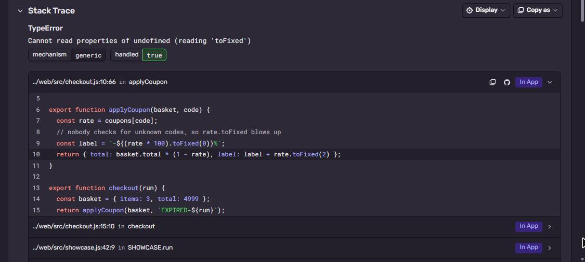
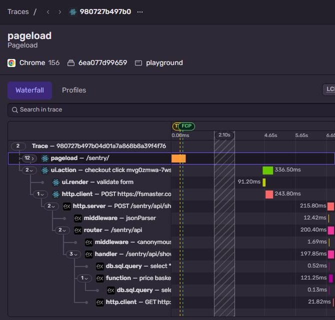

# Sentry Playground

Dashboard with buttons that send **real** events to Sentry. Live at
**[fsmaster.com/sentry](https://fsmaster.com/sentry/)**.



It has two parts:

1. **What Sentry can show.** This page itself (browser JS) + its Node backend generate errors, traces,
   spans, logs, replays, profiles, metrics, cron check-ins, user feedback, and a native crash with
   minidump.
2. **One sample per SDK.** Every SDK has its own small repo with a step by step guide. On the dashboard
   each one has a button that runs that sample.

Every click gets new run id. It goes into the event message, a `run_id` tag and (checkbox on the page)
the fingerprint, so each click is a separate new issue and not "+1 event" to an old one.

## SDK samples

| SDK | Repo | Runs where | What it shows |
|---|---|---|---|
| Python | [sentry-sample-python](https://github.com/fsmaster/sentry-sample-python) | server | exception with local variables |
| Django | [sentry-sample-django](https://github.com/fsmaster/sentry-sample-django) | server | view crash, request data, SQL span |
| PHP | [sentry-sample-php](https://github.com/fsmaster/sentry-sample-php) | server | plain PHP + Composer |
| Ruby | [sentry-sample-ruby](https://github.com/fsmaster/sentry-sample-ruby) | server | sentry-ruby without Rails |
| Go | [sentry-sample-go](https://github.com/fsmaster/sentry-sample-go) | server | error + recovered panic |
| Rust | [sentry-sample-rust](https://github.com/fsmaster/sentry-sample-rust) | server | anyhow context chain + panic |
| Native C/C++ | [sentry-sample-native](https://github.com/fsmaster/sentry-sample-native) | server | real SIGSEGV, minidump, debug symbols |
| AWS Lambda | [sentry-sample-aws-lambda](https://github.com/fsmaster/sentry-sample-aws-lambda) | server (Lambda RIE) | Lambda context, timeout warning |
| Android (Kotlin) | [sentry-sample-android](https://github.com/fsmaster/sentry-sample-android) | GitHub Actions, emulator | R8 obfuscation + ProGuard mapping |
| React Native | [sentry-sample-react-native](https://github.com/fsmaster/sentry-sample-react-native) | GitHub Actions, emulator | Hermes bundle + source map |
| Flutter | [sentry-sample-flutter](https://github.com/fsmaster/sentry-sample-flutter) | GitHub Actions, Linux | obfuscated Dart + debug symbols |
| Unreal Engine | [sentry-sample-unreal](https://github.com/fsmaster/sentry-sample-unreal) | GitHub Actions, Windows | packaged UE5 game crash, PDBs |

Apple (iOS/macOS) is not here yet, for it I need a Mac.

"server" samples run as containers next to the dashboard and answer in a second. "GitHub Actions" ones
need an emulator or Windows, so the button starts the workflow in that repo, the event comes when the
job is done (3-8 min).

## Part 1: the features

| Button | What happens | Where to look in Sentry |
|---|---|---|
| Error + source maps | `checkout.js` throws in the minified bundle | Issues. Frame shows original `checkout.js`, not `index-abc.js` |
| Backend error | Express handler reads missing DB row | Issues, `playground-node` project |
| Distributed trace | browser span → `fetch` → Express → SQL spans → outgoing HTTP | Explore → Traces, one waterfall for browser and backend |
| Custom spans | `Sentry.startSpan` nested 3 levels with attributes | Trace view |
| Logs | `Sentry.logger.info/warn/error` with attributes, both sides | Explore → Logs |
| Session Replay | page types into an input, then error | Replays. Text is masked (`***`), that's default |
| User Feedback | `Sentry.captureFeedback(...)` | User Feedback |
| Profiling | slow `fib()` in browser and Node | Trace → span → Profile, or Explore → Profiles |
| Metrics | counter, distribution, gauge | Explore → Metrics |
| Cron monitor | `Sentry.withMonitor(...)` sends in_progress + ok | Insights → Crons |
| Crash dump | C program segfaults, crashpad uploads minidump | Issues in `sdk-native` |

### Source maps

`vite.config.js`:

```js
build: { sourcemap: "hidden" },
plugins: [
  sentryVitePlugin({
    org: process.env.SENTRY_ORG,
    project: "playground-browser",
    authToken: process.env.SENTRY_AUTH_TOKEN,
    sourcemaps: { filesToDeleteAfterUpload: ["../dist/**/*.map"] },
  }),
],
```

The plugin injects a Debug ID into every JS file and its `.map`, uploads the maps and deletes them, so
they are never served to users. Result, the minified `index-C4gKBM5U.js` turns back into `checkout.js` line 10:



 In Docker the token is passed as build secret
(`RUN --mount=type=secret`), it doesn't stay in any image layer.

### Distributed tracing

Browser SDK adds `sentry-trace` and `baggage` headers to requests that match `tracePropagationTargets`.
Node SDK continues the trace from those headers. Result is one trace with both sides: the click in the
browser, the `fetch`, then Express middleware, handler, SQL queries and the outgoing HTTP call:



```js
// web/src/sentry.js
tracePropagationTargets: [/\/sentry\/api\//],
```

### Replay with masking

`replaysSessionSampleRate: 0` and `replaysOnErrorSampleRate: 1.0`. The SDK keeps last 60 seconds in
memory and sends them only if an error happens. All text and inputs are masked by default, nothing to
configure for PII.

## Run it locally

```bash
git clone https://github.com/fsmaster/sentry-playground.git
cd sentry-playground
npm install
npx vite build
SENTRY_DSN="<dsn of a Node project>" npm start
```

Open http://localhost:3090/sentry/. Browser DSN is in `web/src/sentry.js`, change it to your project.
SDK buttons need the sample containers (see `deploy/docker-compose.yml`), without them they show an error.

## Deploy (what runs on fsmaster.com)

```
nginx  /sentry/  ->  127.0.0.1:3090  dashboard (this repo, Node)
                                       |  POST /sentry/api/sdk/<name>
                                       v
                     docker network: sample-python, sample-django, sample-php, sample-ruby,
                                     sample-go, sample-rust, sample-native, sample-aws-lambda
                                       |
                     GitHub API  ->  workflow_dispatch in android / react-native / flutter / unreal repos
```

```bash
cd /opt && git clone https://github.com/fsmaster/sentry-playground.git
cd sentry-playground/deploy
cp .env.example .env      # DSNs + GitHub token
sh deploy.sh              # docker compose pull + up
```

`deploy/nginx-sentry.conf` goes into the server block. Every image is built by GitHub Actions in its own
repo and pushed to GHCR, the same job creates the Sentry release with commits.

For the CI buttons the server needs a fine-grained GitHub token with **Actions: Read and write** on only
the 4 CI repos. It can start workflows and nothing else.

## Privacy

All playground projects have **Prevent Storing of IP Addresses** on (Settings → Projects → Security &
Privacy). The browser SDK sends `sendDefaultPii: false`, but Sentry still infers the client IP from the
request unless this switch is on. Replays mask all text and inputs by default.

## Limits

The page is public, so the API has a small rate limit (30 clicks/min per IP, one CI run per 3 min per
SDK). Links to Sentry open the fsmaster org, you need access to it. With your own DSNs everything points
to your org.
